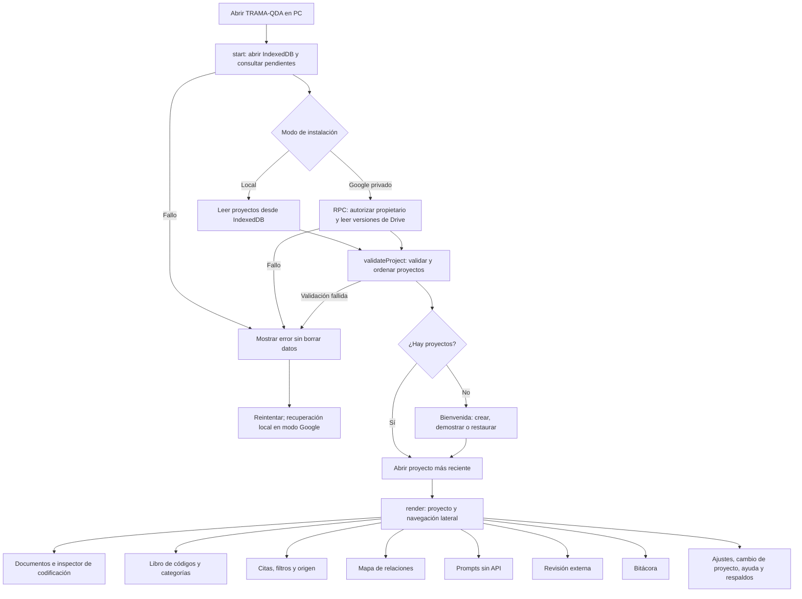
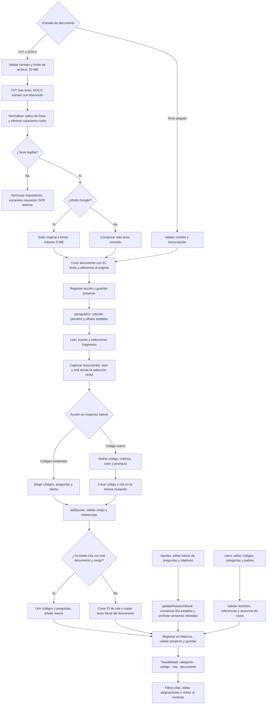
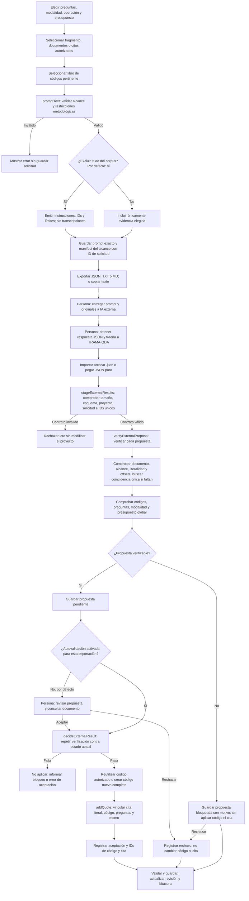
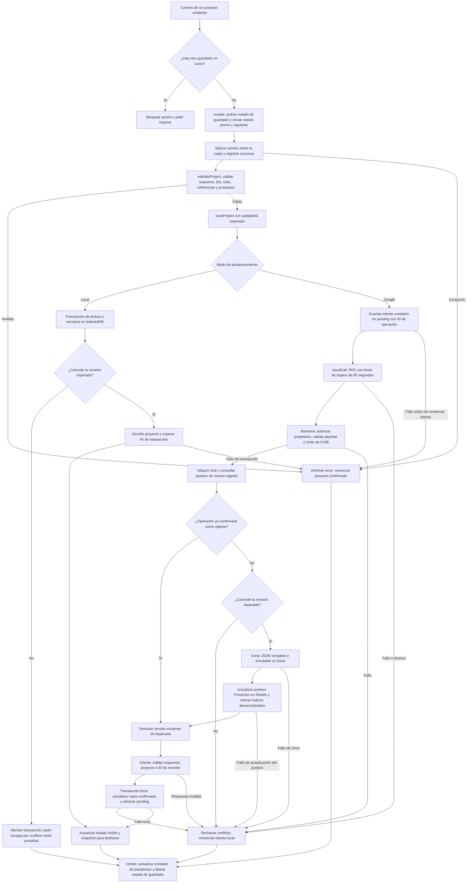
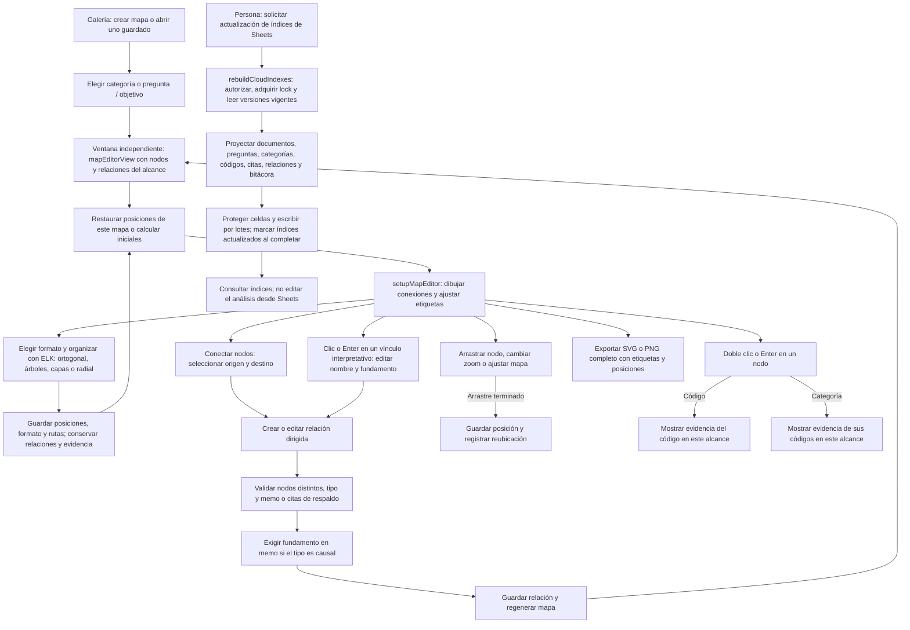
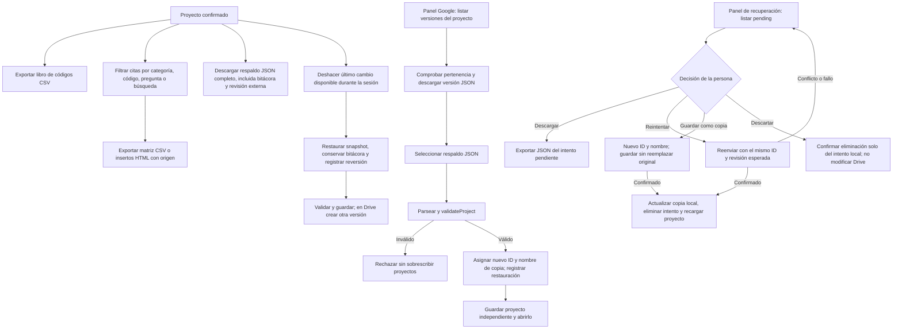
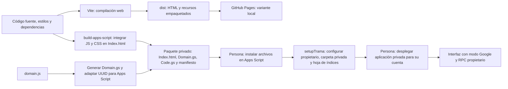

# TRAMA-QDA

Aplicación web de análisis cualitativo **manual y sin API de IA**. Diseñada para uso individual, con trazabilidad entre categorías, códigos, citas y entrevistas.

**Solo para PC:** se usa desde un navegador de escritorio, con ratón y teclado. Ancho de ventana mínimo: 1100 píxeles. No incluye interfaz ni funciones específicas para móviles.

## Usar ahora

**[Abrir TRAMA-QDA](https://estebancofre-coy.github.io/trama-cualitativa/)** · No requiere instalar nada ni contratar una API.

La URL pública utiliza almacenamiento local. Para **guardado privado en Drive, versiones y Sheets**, instala la variante Apps Script siguiendo [Instalar TRAMA-QDA en Google](docs/INSTALAR-GOOGLE.md). El acceso es exclusivo de la cuenta propietaria; no se conecta GitHub Pages a un endpoint público.

1. Crea un proyecto o explora el ejemplo ficticio.
2. Importa DOCX / TXT UTF-8 o pega una entrevista.
3. Crea códigos con definiciones y criterios, categorías y códigos padres.
4. Selecciona texto en Documentos y crea un código desde el inspector lateral para generar una cita vinculada, o asigna códigos existentes y guarda la cita.
5. Recupera citas por código, categoría o pregunta, consulta su contexto y exporta matrices CSV o insertos HTML.
6. Crea o abre mapas guardados por categoría, pregunta u objetivo en ventanas independientes. Vincula nodos, edita etiquetas, organiza cada mapa y exporta SVG o PNG.
7. En **Prompts sin API**, elige una pregunta, modalidad y alcance explícito. Exporta el prompt en JSON, TXT o Markdown. Por defecto no contiene el texto del corpus: adjunta los documentos originales directamente a la IA externa.
8. Importa su respuesta exclusivamente en JSON y revisa los códigos y citas en **Revisión externa** antes de aceptarlos. La autovalidación es opcional y está desactivada en cada importación.
9. **Descarga un respaldo JSON** al terminar cada sesión.

El último cambio del proyecto puede deshacerse durante la sesión actual. La bitácora conserva tanto la acción como su reversión; en Drive, deshacer crea una versión nueva y no elimina los originales ni las versiones previas.

## Privacidad y almacenamiento

- Los proyectos se almacenan en IndexedDB, en este navegador y dirección web.
- En la instalación privada de Apps Script, Drive es el almacenamiento principal. IndexedDB conserva intentos pendientes y una copia de la última confirmación; Sheets contiene índices regenerables a petición. Ningún fallo remoto activa silenciosamente el modo local.
- No hay registro de usuario, servidor de entrevistas, analítica, telemetría ni llamadas a IA.
- El hosting recibe las solicitudes normales de acceso al sitio. Las dependencias se empaquetan con la aplicación, sin CDN en tiempo de ejecución.
- No se sincronizan dispositivos. El modo privado, borrar datos del sitio o perder el equipo puede eliminar los proyectos. El navegador también puede desalojar almacenamiento bajo presión.
- Los respaldos contienen texto, citas, memos, solicitudes e historial **sin cifrar**. Consérvalos de forma segura.
- Restaurar JSON crea una copia independiente; no sobrescribe proyectos existentes.
- Copiar a un chat externo es una acción manual. Sus condiciones y tratamientos de datos son independientes de esta app. Anonimiza, revisa consentimientos y considera la reidentificación contextual.

## Prompts focalizados

En **Ajustes** registra el banco de preguntas y objetivos, uno por línea. Cada solicitud incluye solo los elementos que selecciones, con una consulta focalizada opcional, y uno de estos alcances:

- Fragmento seleccionado en el lector.
- Documentos seleccionados expresamente, sin selección automática del corpus.
- Citas previamente codificadas, seleccionadas individualmente.

Las operaciones de subcodificación, categorización y comparación exigen el alcance de citas. Se incluye solo el libro de códigos elegido. La modalidad deductiva exige códigos existentes. El máximo de propuestas nuevas es un presupuesto de revisión, no una cuota que llenar ni un límite metodológico. Cada paquete se archiva íntegro para conservar el alcance exacto.

Seleccionar varias preguntas pide resultados separados por ID y conserva un presupuesto global de propuestas, sin duplicar códigos por pregunta ni analizar automáticamente todo el banco. Las citas manuales también pueden vincularse a preguntas u objetivos y filtrarse por ellos; esos vínculos se exportan en CSV e insertos HTML. Quitar o reformular un elemento archiva su versión anterior para no romper referencias. Los respaldos anteriores, sin banco, siguen siendo compatibles.

Los prompts nuevos excluyen por defecto los textos de documentos, selecciones y citas. Conservan las instrucciones, preguntas elegidas, libro autorizado e IDs y límites de origen. Puedes desactivar esa opción para incluir texto explícitamente. JSON, TXT y Markdown son formatos de **exportación del prompt**, no de importación de resultados. Las solicitudes antiguas conservan su contenido original; genera una nueva para obtener el contrato verificable.

## Resultados externos JSON

En **Prompts sin API** o **Revisión externa**, usa **Importar resultados JSON** para seleccionar un archivo `.json` o pegar JSON puro. No se aceptan TXT, Markdown ni bloques de código. El prompt emitido contiene el contrato y los IDs reales de proyecto y solicitud:

```json
{
	"schemaVersion": 1,
	"projectId": "ID-del-proyecto",
	"promptId": "ID-de-la-solicitud",
	"proposals": [
		{
			"id": "propuesta-1",
			"documentId": "ID-del-documento-autorizado",
			"text": "Cita literal exacta del documento",
			"code": { "existingId": "ID-del-codigo-autorizado" },
			"researchQuestionIds": [],
			"memo": "Justificación de la propuesta"
		}
	]
}
```

Para un código nuevo, sustituye `code` por `{"name":"Nombre","description":"Definición","inclusion":"Criterios de inclusión","exclusion":"Criterios de exclusión"}`. Cada propuesta vincula un código y una cita. Los códigos nuevos requieren todos esos campos; los existentes deben estar incluidos en el libro autorizado. Los IDs de propuesta deben ser únicos y no haberse importado antes para esa solicitud. Límite: 2 MB y 500 propuestas por importación.

La verificación comprueba proyecto, solicitud, alcance, documento, coincidencia literal, códigos y preguntas autorizados. Si no hay `start` y `end`, localiza únicamente coincidencias literales únicas dentro del alcance. Las citas repetidas exigen offsets exactos en unidades UTF-16 del texto local normalizado, **no posiciones ni páginas de Word**. No se corrigen citas ni se usa coincidencia aproximada. Si el original difiere del texto extraído, revisa la fuente y corrige la respuesta externa; los resultados discrepantes quedan bloqueados.

Importar sin autovalidación no cambia el libro ni las citas. Acepta o rechaza cada propuesta y consulta el documento de origen. La decisión y los vínculos se conservan en el proyecto y la bitácora. Aceptar vuelve a verificar contra el estado actual y deduplica citas por documento y rango. Se mantiene el presupuesto global de códigos nuevos entre importaciones y la modalidad deductiva impide crearlos.

**Autovalidar y aceptar propuestas verificables** está desactivado por defecto y se activa explícitamente para cada importación. Nunca omite bloqueos y no garantiza validez metodológica: solo comprueba integridad textual y referencias. Las categorías, jerarquías y fusiones se registran como propuestas en memos y se aplican manualmente en el libro. No hay llamadas a IA ni descarga automática de sus respuestas.

Los respaldos antiguos siguen siendo compatibles. Al restaurar un proyecto como copia independiente, genera nuevas solicitudes para futuras importaciones externas: las anteriores identifican el proyecto original.

## Importaciones y exportaciones

### Mapas para exposición de resultados

En **Mapa de relaciones**, elige **Crear mapa** o **Abrir mapa** en la galería. Cada mapa tiene nombre, alcance y disposición propios: una categoría con sus códigos, o los códigos de citas vinculadas a una pregunta u objetivo con sus categorías de contexto. Una pregunta sin citas vinculadas muestra un mapa vacío que se actualiza al codificar evidencia.

Los mapas se abren en ventanas separadas; puedes trabajar con varios en paralelo. Si el navegador bloquea una ventana, permite ventanas emergentes para este sitio y usa **Abrir mapa**: el mapa creado sigue guardado. Abrir nuevamente un mapa ya abierto enfoca su ventana. Los botones compactos muestran ayuda al pasar el ratón o recibir foco con el teclado.

Las ventanas comparten los códigos, categorías, citas y relaciones del proyecto, pero no sus posiciones ni formato de organización. Los cambios se guardan automáticamente y se notifican a las demás ventanas del mismo navegador. **Guardar mapa** permite confirmar el nombre o renombrarlo. Eliminar un mapa elimina su vista guardada, no los datos de análisis. Los respaldos JSON incluyen todos los mapas.

En **Mapa de relaciones**, usa **Conectar nodos** y selecciona el origen y el destino, con clic o Enter. El formulario permite elegir una vinculación existente o **Texto personalizado**, añadir su fundamento y vincular citas de respaldo. Puedes editar una relación haciendo clic sobre su línea o etiqueta, usando Enter/Espacio sobre el vínculo o mediante **Revisar** en la lista. Los nombres admiten hasta 120 caracteres. Las conexiones estructurales del libro se editan mediante categorías y códigos padres, no renombrando su significado en el mapa.

El panel **Relación rápida** permite elegir origen, destino y vínculo mediante botones de selección, sin usar desplegables. Incluye búsqueda por nombre para códigos y categorías, un vínculo personalizado opcional y fundamento o citas de respaldo. Los nodos elegidos se destacan en el mapa. No permite relacionar un nodo consigo mismo y mantiene las mismas comprobaciones de evidencia y fundamento causal del método clásico.

Ambos métodos son abatibles. **Construcción con desplegables** conserva el botón **+ Relación** y su formulario original; ábrelo cuando prefieras ese método. La aplicación recuerda qué paneles dejaste abiertos mientras continúa la sesión, incluso después de guardar u organizar el mapa.

El selector **Organización** ofrece cinco formatos con el motor ELK, empaquetado localmente y sin envío de datos:

- **Ortogonal:** capas de izquierda a derecha con conexiones en ángulo recto.
- **Árbol de izquierda a derecha:** disposición horizontal con categorías y padres como origen visual de la jerarquía.
- **Árbol de arriba hacia abajo:** presentación vertical de la estructura.
- **Capas verticales:** disposición jerárquica vertical con rutas ortogonales.
- **Radial:** distribución alrededor de centros para explorar redes.

Pulsa **Organizar mapa** para aplicar y guardar posiciones, formato y rutas del mapa abierto. Las relaciones cíclicas y los nodos desconectados del alcance se conservan: organizar como árbol no convierte la red en un árbol ni elimina vínculos. Tampoco cambia códigos, categorías, citas ni la dirección semántica de sus relaciones. Doble clic o Enter en un nodo abre su evidencia textual sin salir de la ventana.

**Conexiones** permite cambiar entre rectas y ortogonales conservando las posiciones. Puedes arrastrar nodos después de organizar; al moverlos o cambiar la estructura se descartan las rutas automáticas anteriores y se recalculan conexiones locales. Vuelve a organizar para optimizar de nuevo las rutas y sus etiquetas.

Usa zoom para leer detalles y **Ajustar a pantalla** para encuadrar el conjunto. La exportación **Mapa SVG** incluye toda la extensión del diagrama, no solo la parte visible, con etiquetas horizontales, fondo de etiqueta, colores, rutas y posiciones. El archivo es vectorial y puede ampliarse sin perder calidad. Los respaldos JSON y las versiones de Drive conservan la organización; los proyectos anteriores siguen siendo compatibles.

**Mapa PNG** descarga una imagen del mismo diagrama completo sobre fondo blanco, independiente del zoom o desplazamiento del visor. Normalmente se genera a doble resolución. Para no agotar la memoria del navegador, los mapas grandes se reducen proporcionalmente hasta un máximo de 8192 píxeles por lado y 24 millones de píxeles; para ampliaciones sin pérdida conserva el SVG.

| Formato | Uso |
|---|---|
| DOCX | Extracción local de texto con Mammoth. No conserva páginas, formato, imágenes ni tablas como estructura. |
| TXT UTF-8 / pegado | Texto con párrafos y posiciones estables. |
| JSON | Respaldo completo validado y restauración en esta versión de TRAMA-QDA. |
| JSON de resultados | Propuestas externas vinculadas a una solicitud; verificación, aceptación o rechazo. No es un respaldo. |
| JSON / TXT / MD de prompt | Instrucciones exportables, sin texto del corpus por defecto, con contrato de respuesta JSON. |
| CSV con `;` y BOM UTF-8 | Libro de códigos o matriz categoría–código–cita–origen. Protección básica contra fórmulas de hoja de cálculo. |
| HTML | Insertos filtrados para abrir en Word o imprimir a PDF en el navegador. No es un archivo DOCX nativo. |
| SVG | Mapa vectorial con etiquetas y posiciones. |
| PNG | Imagen del mapa completo con fondo blanco, lista para presentaciones e informes. |

El texto importado es inmutable para no desplazar referencias. Los localizadores son párrafos y posiciones en el texto extraído, **no páginas del documento original**. Las categorías de los subcódigos se asignan explícitamente. Los filtros actuales se aplican a las exportaciones de citas.

## Desarrollo local

Requiere Node.js 20.19+ o 22+.

```powershell
npm ci
npm run dev:local
```

La sesión local usa `http://127.0.0.1:4174/`. El puerto es fijo: si está ocupado, no se cambia automáticamente a otra dirección. Si el servidor ya está activo, usa esa misma URL sin iniciarlo otra vez.

Para conservar el análisis, utiliza siempre el mismo navegador, perfil y dirección, sin modo incógnito. IndexedDB pertenece al origen web: cambiar puerto, dirección, perfil o equipo no traslada los proyectos. Descarga un respaldo JSON desde la aplicación antes de cambiar de entorno y restáuralo en la nueva sesión. Los checkpoints de código no incluyen IndexedDB ni sustituyen ese respaldo.

Los cambios de código sin commit permanecen en el directorio de trabajo. La carpeta ignorada `.local-checkpoints/` puede guardar checkpoints privados con una copia de los fuentes, parches separados del índice y del directorio de trabajo y un bundle del historial Git. Conserva una copia fuera del contenedor antes de eliminar o reconstruir el entorno; no subas respaldos de investigación al repositorio.

```powershell
npm test
npm run build
npm run build:google
npx playwright install chromium
npm run test:e2e
```

## Publicación

El workflow `.github/workflows/pages.yml` prueba, compila y publica únicamente `dist` al enviar cambios a `main`. Configura GitHub Pages con **GitHub Actions** como fuente. No agregues entrevistas, respaldos ni archivos `.env` al repositorio público.

## Límites

Primera versión individual: sin edición colaborativa, sincronización, cifrado local, deshacer global, audio, video, OCR, PDF ni importación de proyectos propietarios de ATLAS.ti. Los mapas permiten relaciones manuales y arrastre; no calculan causalidad ni hacen inferencias automáticas. Los nombres extensos se abrevian visualmente en los nodos, pero se conservan completos en el libro. Conviene conservar los originales fuera de la app y dividir proyectos muy grandes.

La variante Google permite abrir el proyecto desde distintos PC con la misma cuenta y detecta conflictos de revisión, pero no combina ediciones concurrentes. Cada guardado crea un JSON inmutable en Drive; un puntero en la hoja Proyectos identifica la versión vigente. Las pestañas de índices no son una base transaccional ni el lugar para editar el análisis.

No está afiliada a ATLAS.ti.

## Flujos de procesos internos

Los diagramas describen la implementación actual. Las operaciones de investigación no son pasos obligatorios en un orden único: los siete espacios del proyecto pueden recorrerse de forma iterativa. La IA externa se utiliza manualmente y no forma parte del backend de TRAMA-QDA.

### 1. Inicio y navegación general



### 2. Corpus, codificación y trazabilidad



El texto fuente no se edita después de importarse. Las categorías se asignan explícitamente a cada código, incluidos los subcódigos. Los localizadores son posiciones del texto extraído, no páginas del archivo Word.

### 3. Prompts y revisión de resultados externos



Las flechas discontinuas representan transferencias manuales fuera de la aplicación. La importación admite hasta 500 propuestas; los archivos JSON tienen un límite de 2 MB. La autovalidación solo comprueba integridad textual y referencias, no calidad metodológica. Las propuestas de categorías, jerarquías y fusiones se describen en memos y se aplican manualmente en el libro.

### 4. Mutación, persistencia y conflictos



La creación, demostración y restauración de proyectos usan `saveProject` directamente, sin snapshot de deshacer. No existe fallback silencioso de Drive a almacenamiento local. Un error anterior a la escritura en `pending` no garantiza que haya un intento recuperable. Un timeout puede ocurrir después de que Google haya recibido la operación.

### 5. Mapa e índices consultables



Los índices se reconstruyen a petición, no en cada guardado. No contienen transcripciones completas y no sustituyen los JSON canónicos de Drive. Cada entrada de `savedMaps` conserva su alcance, posiciones y organización dentro del proyecto; zoom y ajuste de vista no se guardan como posiciones de nodos. `BroadcastChannel` notifica cambios entre ventanas del mismo origen; el almacenamiento sigue siendo local o Drive, según la instalación. No implica colaboración ni sincronización entre dispositivos.

### 6. Exportaciones, respaldo, versiones y recuperación



Restaurar o recuperar como copia no reemplaza el proyecto original. Para futuras importaciones externas en una copia, genera nuevas solicitudes con el nuevo ID de proyecto. Deshacer solo revierte el último cambio disponible en la sesión; no es un historial multinivel.

### 7. Construcción y distribución



La publicación pública distribuye código, no entrevistas ni respaldos. La instalación privada requiere autorización y despliegue de la persona propietaria en Google.
